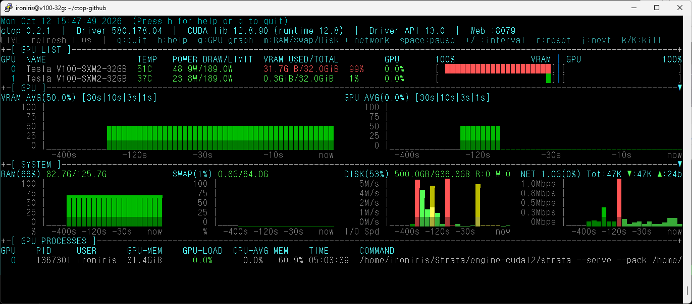
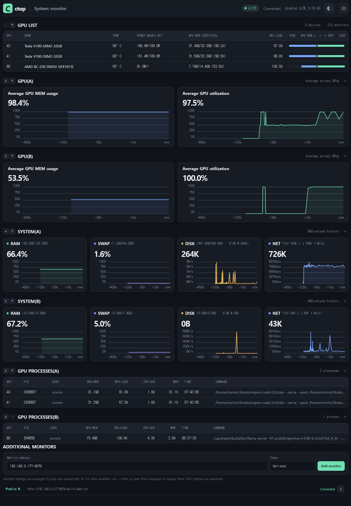

# ctop

AMD/NVIDIA GPU, 시스템 메모리, 프로세스, 네트워크 및 디스크 I/O를 터미널에서 확인하는 가벼운 모니터링 도구입니다.

C11 기반 단일 C 프로그램이며 curses 라이브러리를 사용하지 않습니다. NVIDIA GPU 정보는 NVML에서, AMD 장치 식별은 Vulkan에서 처리하며 AMD 센서 데이터는 Linux `amdgpu` 인터페이스에서 읽습니다.

[English README](README.en.md)





## 주요 기능

- GPU 온도, 전력, 메모리, GPU 사용률 표시
- GPU 프로세스별 GPU 메모리, GPU Load/CPU 사용률, 프로세스 호스트 RAM 비율 표시
- RAM/SWAP 사용량 및 히스토리 그래프
- 디스크 I/O 실시간 그래프와 최근 400초 최대 피크 기준 Y축
- GPU 메모리/사용률 히스토리 그래프
- 네트워크 처리량을 bit/s 단위로 표시
- 인터페이스별 실제 링크 속도를 기준으로 네트워크 사용률 계산
- RX/TX 방향 표시 및 인터페이스별 네트워크 정보
- Docker 관련 인터페이스(`docker*`, `br-*`, `veth*`) 제외
- 마우스로 섹션 접기/펼치기
- 선택 가능한 alternate-screen 모드

## 필요한 환경

### 컴파일 시

- Linux 및 C11을 지원하는 GCC
- NVIDIA 백엔드에는 `nvml.h` (NVML stub 또는 전체 CUDA Toolkit 불필요)
- Vulkan 백엔드에는 Vulkan 헤더와 loader 개발 라이브러리
- 기본 glibc, `libdl`, `libm`

기본 `auto` 빌드는 설치된 개발 파일에 따라 NVIDIA, Vulkan 또는 두 백엔드를 선택합니다. `--backend nvidia|vulkan|both`로 직접 선택할 수도 있습니다. 헤더 경로는 `NVML_INCLUDE_DIR`/`CUDA_ROOT`, `VULKAN_INCLUDE_DIR`로 지정할 수 있으며, Vulkan loader 경로는 `VULKAN_LIBRARY_DIR`로 지정할 수 있습니다.

의존성만 확인하려면:

```bash
./build-ctop.sh --check
./build-ctop.sh --check --backend both
```

### 실행 시

- NVIDIA GPU 모니터링에는 NVML을 제공하는 NVIDIA 드라이버가 필요합니다 (`nvidia-smi` 정상 동작).
- AMD GPU 모니터링에는 Vulkan loader, `amdgpu` 커널 드라이버 및 접근 가능한 DRM/sysfs 정보가 필요합니다.
- TUI 실행 시 Linux의 실제 터미널(TTY)과 최소 터미널 크기 76열 x 13행 필요
- 웹 전용(`--no-tui`) 실행에는 TTY 불필요

다음 `/proc` 및 `/sys` 파일을 사용합니다.

```text
/proc/meminfo
/proc/net/dev
/proc/stat
/proc/uptime
/proc/diskstats
/sys/class/net/<interface>/speed
```

## 사전 설치

Ubuntu/Debian 계열에서 기본 빌드 도구를 설치합니다.

```bash
sudo apt update
sudo apt install build-essential
```

AMD/NVIDIA GPU를 사용할 경우 해당 커널 드라이버를 설치합니다. NVIDIA GPU는 다음 명령으로 확인할 수 있습니다.

```bash
nvidia-smi
```

AMD 백엔드에는 Vulkan 개발 패키지가 필요합니다 (Ubuntu/Debian: `libvulkan-dev`). NVIDIA 백엔드에는 `nvml.h`를 제공하는 NVML 개발 패키지가 필요합니다. `nvml.h` 위치는 다음과 같이 확인할 수 있습니다.

```bash
find /usr/local -name nvml.h 2>/dev/null
```

## 설치

다음 명령은 매번 GitHub의 최신 릴리스를 확인하고, 소스를 다운로드해 빌드한 뒤 설치합니다. 기존 `/usr/bin/ctop`가 있으면 그 위치를 갱신하고, 없으면 `/usr/local/bin/ctop`에 설치합니다. 권한이 필요한 경우 sudo를 요청하며, `/usr`가 읽기 전용이면 `/usr/local/bin`으로 대체합니다.

```bash
curl -fsSL https://raw.githubusercontent.com/ironiris/ctop/main/install-ctop.sh | sh
```

`/usr/bin/ctop`에 설치하려면 `--prefix /usr`를 지정합니다.

```bash
curl -fsSL https://raw.githubusercontent.com/ironiris/ctop/main/install-ctop.sh | sh -s -- --prefix /usr
```

서비스가 `~/ctop/ctop`처럼 별도 실행 파일을 사용한다면 해당 디렉터리를 지정합니다.

```bash
curl -fsSL https://raw.githubusercontent.com/ironiris/ctop/main/install-ctop.sh | sh -s -- --bindir "$HOME/ctop"
```

설치 스크립트는 기본 도구(`curl`, `gcc`, `tar`, `awk`)가 없으면 감지한 OS 패키지 매니저로 설치합니다. Bazzite 등 rpm-ostree 시스템은 새 배포를 만든 뒤 재부팅이 필요합니다. GPU SDK와 개발 헤더는 자동 설치하지 않으며, 누락된 백엔드 의존성은 빌드 단계에서 안내합니다. 실행 중인 ctop 프로세스는 설치 후 재시작해야 업데이트됩니다. 서비스가 저장소 안의 별도 실행 파일을 직접 가리키는 경우 `--bindir`로 해당 경로를 지정하세요.

## 직접 컴파일

프로젝트 디렉터리에서 실행합니다.

```bash
./build-ctop.sh
```

백엔드는 자동 선택됩니다. 필요하면 직접 지정할 수 있습니다.

```bash
./build-ctop.sh --backend auto
./build-ctop.sh --backend nvidia
./build-ctop.sh --backend vulkan
./build-ctop.sh --backend both
```

NVML 헤더가 기본 경로에 없다면 `NVML_INCLUDE_DIR=/path/to/include` 또는 `CUDA_ROOT=/path/to/cuda`를 지정합니다.

정상적으로 완료되면 프로젝트 디렉터리에 `ctop` 실행 파일이 생성됩니다. 웹 대시보드의 HTML/CSS/JS 리소스도 이때 실행 파일에 포함됩니다.

## 실행

```bash
./ctop
```

주요 옵션:

```text
-i, --interval N          갱신 주기(초)
-p, --port PORT           웹 대시보드를 지정한 포트로 함께 실행
--monitor ADDRESS         TUI와 웹에서 공유할 원격 HTTP 모니터 추가(반복 가능)
--no-tui                  TUI 없이 웹 대시보드만 실행(-p 필요)
--localhost               웹 접속을 127.0.0.1로 제한(-p 필요)
-t, --token TOKEN         웹 대시보드와 API에 접근 토큰 요구(-p 필요, CTOP_TOKEN 환경변수도 가능)
--no-color                ANSI 색상 끄기
--debug-log FILE          디버그 로그 파일
-a, --alternate-screen    종료 시 기존 화면 복원
-r, --restore-screen      --alternate-screen 별칭
-v, --version             버전 표시
```

예시:

```bash
./ctop -i 1
./ctop --no-color
./ctop --alternate-screen
./ctop -p 8079
./ctop -p 8079 --localhost
./ctop -p 8079 --token "$(openssl rand -hex 16)" --localhost
./ctop --monitor 192.168.0.177:8079
./ctop --no-tui --port 8079
```

## 웹 대시보드와 API

`-p 8079`를 지정하면 기존 터미널 화면과 웹 대시보드를 함께 실행합니다. 브라우저에서 `http://<서버 주소>:8079/`를 여세요. TUI 병행 모드에서는 감지된 웹 모니터 주소(예: `http://192.168.0.177:8079`)가 TUI 오른쪽 위에 표시됩니다. `--localhost` 지정 시 `http://127.0.0.1:8079`로 표시됩니다. TUI 없이 웹 대시보드만 실행하려면 `--no-tui`를 추가합니다. 대시보드 헤더의 카메라 아이콘으로 스크린샷을 클립보드에 복사할 수 있습니다. 클립보드 복사가 지원되지 않으면 이미지 파일로 저장합니다.

대시보드 하단 `ADDITIONAL MONITORS`에서 다른 ctop 주소를 추가하면 같은 모니터가 TUI와 웹 양쪽에 등록됩니다. 반대로 TUI에서 추가한 모니터도 웹에 표시됩니다. 주소/호스트, 포트, 토큰이 모두 같을 때만 중복으로 처리하며, 토큰이 다르면 별도 모니터입니다. 접두어(`A`, `B` 등)는 자동 할당됩니다. 원격 연결이 끊겼다가 복구되면 웹 페이지를 새로고침해 연결 상태를 갱신합니다. TUI 원격 모니터 데이터도 웹 API에 포함됩니다. `--token` 없이 실행하면 네트워크의 다른 사용자도 데이터를 보고 모니터 목록을 변경할 수 있으므로, 외부 네트워크에 노출할 때는 `--token`을 설정하세요. 이 옵션을 설정했다면 먼저 현재 웹 대시보드에 로그인해야 합니다. 웹 폼의 `TOKEN`은 연결 대상 ctop 서버용이며 대시보드 토큰과 별개입니다. `GPU PROCESSES`의 `GPU-MEM`은 프로세스의 GPU 메모리이고, `MEM`은 모니터링 대상 호스트 전체 RAM 대비 해당 프로세스의 RSS 비율입니다. `SYSTEM`의 RAM 사용량은 시스템 전체를 `MemAvailable` 기준으로 계산하므로 `MEM`과 다르며, 프로세스별 `MEM`을 합해도 `SYSTEM` 값과 일치하지 않습니다. 원격 주소는 ctop 서버에서 접근 가능해야 하며, TUI와 웹은 같은 연결 설정을 사용합니다. TUI 원격 연결은 HTTP만 지원하므로 신뢰할 수 없는 네트워크에서는 토큰을 보내지 마세요. 각 섹션 순서와 접힘 상태는 웹 브라우저와 TUI에서 별도로 설정됩니다.

현재 상태와 그래프 히스토리는 JSON API로도 조회할 수 있습니다.

```bash
curl http://localhost:8079/api/v1/metrics
```

`--token`을 지정하면 `/login`과 아이콘 파일(`/favicon.svg`, `/favicon.ico`)을 제외한 모든 경로가 보호됩니다. 브라우저에서는 첫 접속 시 토큰 입력 화면이 뜨고, 인증 후 7일짜리 쿠키로 유지됩니다. 쿠키가 만료되거나 사라지면 대시보드 안의 입력창에 토큰을 다시 넣어야 합니다. 그 입력창에 넣은 토큰만 로컬스토리지에 저장되어 이후에는 쿠키가 사라져도 자동으로 재인증되며, 로그인 화면에서 입력한 토큰은 저장되지 않습니다. 스크립트에서는 아래 두 방법 중 하나를 씁니다.

```bash
curl -H "Authorization: Bearer 토큰" http://localhost:8079/api/v1/metrics
curl "http://localhost:8079/api/v1/metrics?token=토큰"
```

응답에는 GPU, 프로세스, RAM/SWAP, 디스크, 네트워크의 현재값과 그래프 히스토리가 JSON으로 포함됩니다(`application/json`). `/api/metrics`도 같은 응답을 반환합니다. 히스토리 샘플에는 현재 시점으로부터의 경과 시간(`age_seconds`)과 측정값(`value`)이 포함되며, NET 히스토리의 측정값은 bit/s 처리량이고 샘플 간격은 `sample_interval`(초)로 제공됩니다. 400초 구간의 샘플이 500개를 넘으면 구간별로 축약하되 각 구간의 최솟값과 최댓값은 그대로 남깁니다. GPU 평균은 측정값을 정상적으로 반환한 장치 기준으로 계산합니다. 웹 서버는 기본적으로 모든 네트워크 인터페이스(`0.0.0.0`)에서 연결을 받습니다. 로컬에서만 접속하려면 `--localhost`를 지정하세요. `--token`을 지정하지 않으면 웹 페이지와 API가 인증 없이 열립니다. 다중 모니터링을 위해 metrics API는 교차 출처 브라우저 요청을 허용하므로, 네트워크에 노출하는 인스턴스에는 `--token`을 설정하세요.

## TUI 원격 모니터와 키 조작

화면 하단 `REMOTE` 칸에 `host:port` 주소를, 뒤의 `TOKEN` 칸에 필요한 토큰을 입력한 뒤 `ADD` 버튼을 눌러 연결합니다. 이 목록은 웹 대시보드와 공유되며, 두 UI 중 한쪽에서 추가하거나 삭제하면 다른 쪽에도 반영됩니다. 주소를 입력해도 `ADD` 전에는 연결하거나 모니터 섹션을 만들지 않습니다. 마우스로 각 칸을 클릭하거나 `a`로 주소 칸에 포커스할 수 있습니다. 키보드에서는 Tab/Enter로 TOKEN과 ADD 버튼으로 이동하고, ADD 버튼에 포커스했을 때 Enter를 누르면 연결됩니다. 주소는 `http://host:port` 형식도 가능하며 `/api/v1/metrics` 경로가 자동으로 붙습니다. 원격 GPU는 GPU LIST에 합쳐지고, GPU 그래프·SYSTEM·GPU PROCESSES는 모니터별 섹션으로 표시됩니다. 시작할 때 `--monitor ADDRESS`를 반복해 지정할 수도 있습니다. TUI 원격 연결은 현재 HTTP만 지원하며, 토큰은 암호화되지 않은 연결로 전송하지 마세요.

```text
q / Esc                   종료
h                         도움말 표시/숨김
a                         하단 REMOTE 주소 칸에 포커스
Tab / Enter               TOKEN, ADD 버튼으로 포커스 이동
[ / ]                     섹션 선택
u / d                     선택한 섹션을 위/아래로 이동
x                         선택한 원격 모니터 제거
c                         선택한 섹션 접기/펼치기
g / m                     GPU / SYSTEM 섹션 접기/펼치기
Space                     일시정지/재개
+ / -                     갱신 주기 변경
r                         그래프 히스토리 초기화
j                         다음 GPU 프로세스 선택
k / K                     선택한 로컬 프로세스 종료 확인
```

섹션 순서는 현재 TUI 세션 동안 유지됩니다. 터미널이 SGR 마우스를 지원하면 제목 앞의 `▲`/`▼`로 섹션을 위아래로 옮기고, 오른쪽 삼각형으로 접고 펼칠 수 있습니다.

## 디스크 표시 방식

SYSTEM 섹션의 디스크 정보는 다음 형식으로 표시합니다.

```text
DISK(XX%) XXX.XGB/YYY.YGB R:읽기값 W:쓰기값
```

`XXX.XGB`는 현재 사용량, `YYY.YGB`는 전체 용량입니다. `R:`과 `W:`에는 각각 읽기 및 쓰기 처리량이 표시됩니다(예: `W:271K`). I/O 그래프는 파티션과 `loop*`, `ram*`, `zram*` 장치를 제외한 블록 장치들의 읽기/쓰기 처리량 합계를 표시합니다. Y축 최고값은 최근 400초 동안 측정된 최대 피크로 자동 설정되며, 0~100% 기준이 아닙니다. 용량은 기본적으로 루트 파일시스템(`/`) 기준입니다. `/`가 `composefs`, `overlay` 등 가상 파일시스템이면 현재 mount 목록에서 가상 파일시스템을 제외하고 가장 큰 실제 파일시스템을 선택합니다(Bazzite에서는 보통 `/var`). 사용할 경로를 직접 지정하려면 `CTOP_DISK_PATH=/경로`를 설정하세요. 가상 root 외에 읽을 수 있는 실제 파일시스템이 없으면 용량은 `N/A`로 표시됩니다.

## 네트워크 표시 방식

네트워크 카운터의 byte 차이를 bit로 변환하여 표시합니다.

```text
NET | <링크속도>(사용률) | TOTAL:처리량 | ▼:수신 | ▲:송신
```

`/sys/class/net/<interface>/speed`에서 인터페이스별 링크 속도를 읽어 사용률을 계산합니다. 속도를 읽을 수 없는 인터페이스는 사용률을 `N/A`로 표시합니다. Docker 컨테이너가 외부로 통신하는 경우에도 호스트의 물리 NIC를 통과한 트래픽은 호스트 전체 사용량으로 집계됩니다. 단, 컨테이너별 사용량을 따로 구분하지는 않습니다.

## 주의사항

- NVIDIA 백엔드는 NVML 헤더가 필요하며, NVIDIA 드라이버가 설치된 시스템에서 NVML을 동적으로 불러옵니다. NVML stub 라이브러리는 필요하지 않습니다.
- Vulkan 백엔드는 AMD 장치를 열거하고, 온도·전력·메모리·사용률은 Linux `amdgpu` DRM/sysfs에서 읽습니다. 커널에서 `gpu_busy_percent`를 제공하지 않으면 `/proc/<pid>/fdinfo` DRM 엔진 시간 차이로 사용률을 계산합니다.
- 네트워크 링크 속도를 읽을 수 없는 인터페이스는 사용률을 계산할 수 없습니다.
